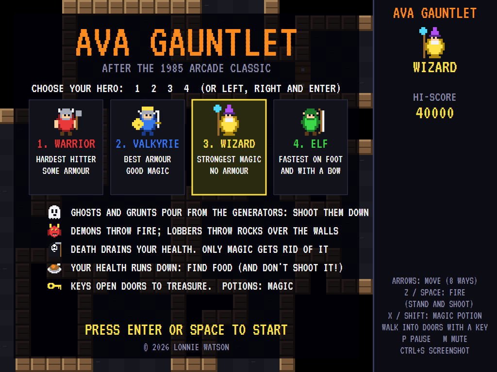
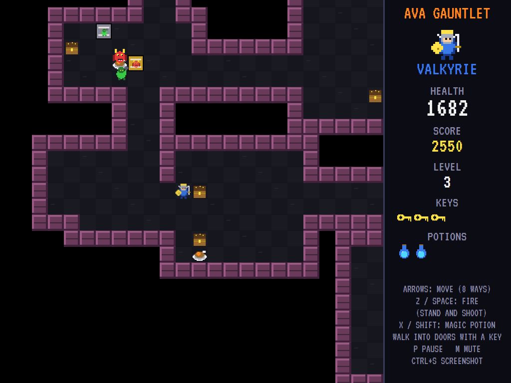
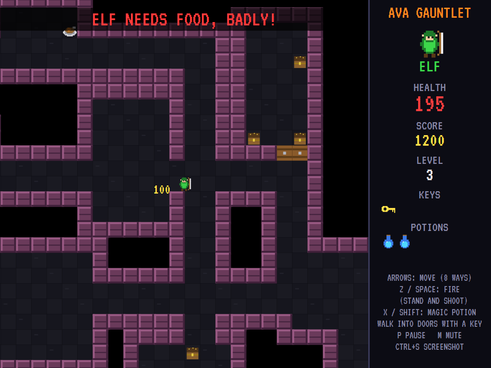
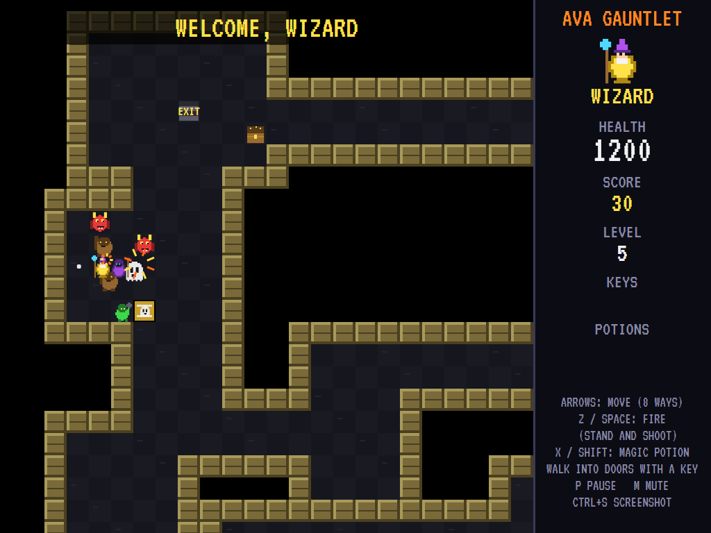
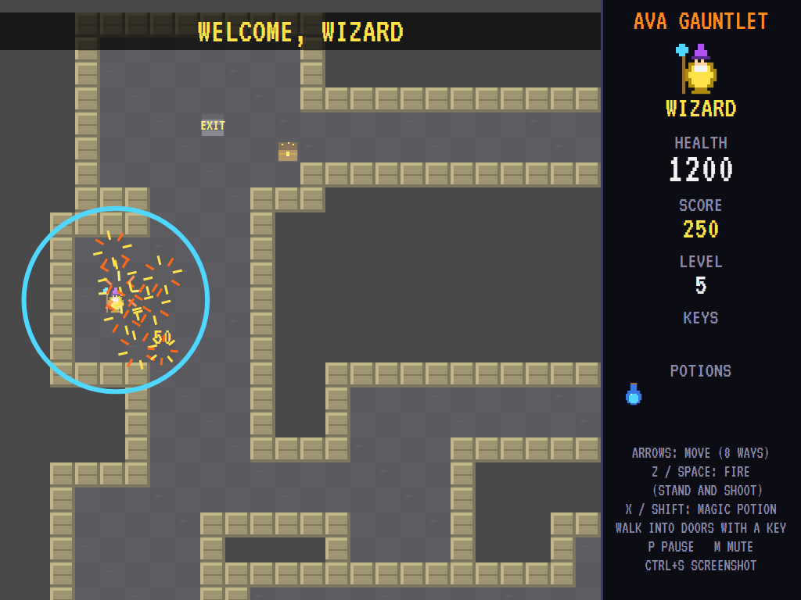
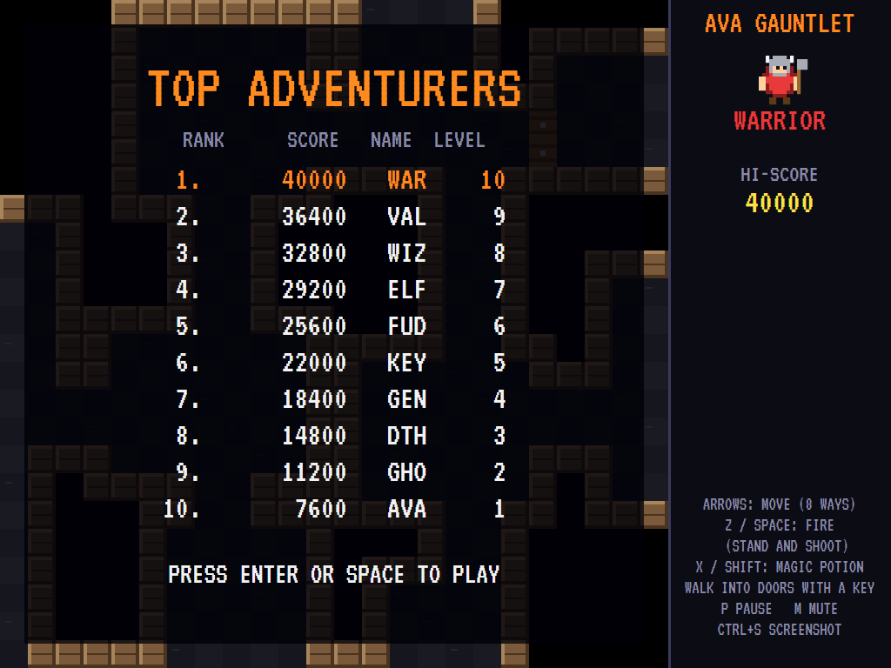

# AVAGauntlet

[](https://github.com/Harlock123/AVAGauntlet/actions/workflows/build.yml)

A dungeon-crawling shoot-'em-up in the style of Atari's 1985 arcade game **Gauntlet**, built with .NET
10 and Avalonia UI. Choose a hero and fight your way down through level after level of dungeon. Hordes
pour out of monster generators, your health runs down by the second, and the narrator has things to say
about it. Find food, keys, treasure and magic potions, and find the exit.

## Features

- **Four heroes**, each with their own strengths:
  - **Warrior**: the hardest hitter, with some armour.
  - **Valkyrie**: the best armour, and good magic.
  - **Wizard**: the strongest magic, but no armour.
  - **Elf**: the fastest, both on foot and with his bow.
- **Health** that runs down by one every second, and faster when things hit you. Food puts it back,
  if you don't shoot it first ("ELF SHOT THE FOOD!"). Run low and the narrator lets you know:
  "WARRIOR NEEDS FOOD, BADLY!"
- **Generators** pour monsters out while you're near, each keeping a handful about at once. Shoot a
  generator down level by level, or watch its monsters keep coming.
- **The monsters**:
  - **Ghosts** fly at you and hit once.
  - **Grunts** club you up close.
  - **Demons** keep their distance and throw fire.
  - **Lobbers** throw rocks over the walls.
  - **Sorcerers** fade from sight, and can't be hit while they're gone.
  - **Death** drains your health and can't be shot. Only magic gets rid of it, or it leaves once it
    has had its fill.
  
  Monsters made by a stronger generator are tougher. They find their way to you round the walls.
- **Potions**: magic destroys everything nearby and knocks the generators down, by as much as your
  hero's magic.
- **Keys and doors**: a key opens a whole door. Behind each door is a treasure room.
- **Endless dungeon**: rooms joined by wide corridors, worked out from the level number, so each
  level is the same every time. Each one gets bigger and busier, with new kinds of monster. Doors
  only ever guard dead-end treasure rooms, with the key to be found elsewhere, so the way to the exit
  never needs one. The tests check every level.
- **Sound**: brooding original dungeon music, the bow and the axes, the monsters going down, the food,
  the keys and doors, the magic and Death's touch, all mixed by OpenAL.
- **Attract mode**: leave the title alone for 15 seconds and a computer player plays a demonstration
  with a hero picked at random:
  - **Shooting**: it fires only at what its shots can reach, generators first.
  - **Survival**: it uses magic on crowds and runs from Death.
  - **Objectives**: it fetches food when it's getting weak, takes the shortest way to each generator,
    picks up what it passes, and heads for the exit. Every hero gets through each of the first eight
    levels.
- **A top-ten high-score table** with arcade-style initials entry. It records how deep you got.
- **Any window size**: the screen scales to fit, letterboxed. **Ctrl+S** saves a screenshot.
- **One self-contained executable** per platform: Windows, macOS and Linux on Intel/AMD and ARM.

## Screenshots

| Title screen | A level under way | Needs food, badly |
|:------------:|:-----------------:|:-----------------:|
|  |  |  |
| Choose your hero. | The valkyrie, keys and potions in hand, a generator ahead. | The elf, running low, a locked treasure room behind its door. |

| A horde | Magic | The high-score table |
|:-------:|:-----:|:--------------------:|
|  |  |  |
| Closing in on the wizard. | A potion, and they're gone. | The best adventurers. |

The screenshots are made by the tests, which play the game in a real (headless) window; see
[Tests](#tests).

## Download and run

Ready-to-run builds for Windows, macOS and Linux, on both Intel/AMD and ARM, are on the
[Releases page](https://github.com/Harlock123/AVAGauntlet/releases/tag/latest). **Latest build** is
rebuilt on every push to `main`. Each download is one self-contained executable: no .NET install is
needed.

| Platform | Archive |
|---|---|
| Windows | `AVAGauntlet-win-x64.zip`, `AVAGauntlet-win-x86.zip`, `AVAGauntlet-win-arm64.zip` |
| macOS | `AVAGauntlet-osx-arm64.tar.gz` (Apple silicon), `AVAGauntlet-osx-x64.tar.gz` (Intel) |
| Linux | `AVAGauntlet-linux-x64.tar.gz`, `AVAGauntlet-linux-arm64.tar.gz`, `AVAGauntlet-linux-arm.tar.gz` |

```bash
tar -xzf AVAGauntlet-linux-x64.tar.gz     # or linux-arm64, linux-arm, osx-arm64, osx-x64
./AVAGauntlet
```

On Windows, unzip and run `AVAGauntlet.exe`. On macOS, if Gatekeeper refuses to open it, run
`xattr -d com.apple.quarantine AVAGauntlet` once. Run with `--no-audio` for silence.

**Sound** comes through OpenAL Soft, built in for every platform. In a virtual machine the game
detects it and uses a larger audio buffer, so the sound doesn't break up.

**Gamepads** use SDL2, which is bundled for Windows, macOS and Intel/AMD Linux. ARM Linux builds need it
installed; without it the keyboard still works:

```bash
sudo apt install libsdl2-dev            # Debian / Ubuntu / Raspberry Pi OS
sudo pacman -S --needed sdl2-compat     # Arch / Omarchy
```

## Controls

| Input | Action |
|-------|--------|
| **1** to **4** on the title screen | Start as the warrior, valkyrie, wizard or elf |
| **Left** / **Right**, then **Enter** / **Space** | Or choose and start |
| **Arrow keys** / **WASD** / number pad | Move, eight ways |
| **Z** / **Space** / **Ctrl** (hold) | Fire: the hero stands and shoots the way the arrows point |
| **X** / **Shift** | Magic (a potion) |
| Walk into a door | Open it, with a key |
| **P** / **Esc** | Pause (Esc again to quit) |
| **M** | Mute |
| **Ctrl+S** / **Cmd+S** | Save a screenshot to the Pictures folder |

**Gamepad**: left stick or D-pad to move, **A** to fire, **B** or **Y** for magic; **Start** or **A**
starts, **Start** pauses, **Back** (while paused) quits.

**Entering initials**: type letters, or dial with **Up**/**Down** and accept with **Space**; **Left** /
**Backspace** go back; **Enter** finishes.

## Scoring

| What | Points |
|---|---:|
| A ghost, a grunt | 10, 20 |
| A demon, a lobber, a sorcerer | 30 |
| Death (by magic) | 500 |
| A shot on a generator, and bringing it down | 10 each, and 50 |
| Treasure, a key, a potion | 100, 100, 50 |
| Food | 100 health |

## Tests

```bash
dotnet test AVAGauntlet.slnx
```

The engine has no UI and runs in fixed 60 Hz steps, so it plays the same at any frame rate, and a seed
always plays the same game. The tests check:

- every level for twelve: the exit reachable, a key (reachable without one) for every locked room,
  everything reachable with the doors open;
- the heroes' strengths; health running down and food; shooting the food; walls stopping heroes and
  shots;
- shots by the hero's strength; ghosts and armour; monsters finding their way round walls; grunts,
  demons and lobbers (over the wall); Death, and magic;
- generators making monsters and being shot down; potions; keys and doors; treasure and the exit;
- the low-health warning and running out; the title tune, choosing a hero, the demonstration's
  sound, pausing, and every sound and sprite.

A computer player (the attract-mode one) plays whole games in them and must get through the first
level.

The screenshot tests draw the real screen in a headless window. To refresh the README's pictures:

```bash
GAUNTLET_SHOTS=$PWD/Images dotnet test tests/AVAGauntlet.Tests --filter ScreenshotTests
```

## Building

```bash
dotnet build AVAGauntlet.slnx
dotnet run --project src/AVAGauntlet
```

Needs the .NET 10 SDK. The sounds are made by `tools/make_sounds.py` (standard-library Python):
`python3 tools/make_sounds.py` rewrites `src/AVAGauntlet/Sounds`.

## Project structure

```
AVAGauntlet/
├── AVAGauntlet.slnx
├── src/AVAGauntlet/
│   ├── Engine/
│   │   ├── GameEngine.cs        # States, choosing a hero, the narrator, scoring and the music
│   │   ├── GameEngine.Play.cs   # Moving and shooting, food, keys, doors and treasure, magic, the
│   │   │                        # generators, the monsters and how they find you, and the levels
│   │   ├── Entities.cs          # The heroes and their strengths, monsters, generators, items, shots
│   │   ├── AttractPilot.cs      # The computer player for the demonstration (and the tests)
│   │   ├── HighScoreTable.cs, InitialsEntry.cs
│   │   ├── InputHandler.cs, ControllerManager.cs  # Keys and an SDL2 gamepad
│   │   └── SoundManager.cs      # Effects, the dungeon music and the tunes through OpenAL
│   ├── Audio/                   # The OpenAL engine (from the author's AVABand)
│   ├── Models/                  # The dungeon generator, and the pixel art
│   ├── Views/                   # The screen: the dungeon view, the hero's panel, title and tables
│   └── Sounds/                  # The synthesised effects and tunes
├── tests/AVAGauntlet.Tests/     # Gameplay and screenshot tests
├── tools/make_sounds.py
└── Images/                      # Screenshots
```

## About and licence

AVAGauntlet © 2026 Lonnie Watson, under the [MIT License](LICENSE).

*Gauntlet* © 1985 Atari Games; the name belongs to its current owner. AVAGauntlet is an independent,
unofficial game in its style. Its dungeons, graphics, sounds, tunes and code are its own; nothing is
taken from the arcade machine's program, mazes, graphics, sound or speech. It is not affiliated with or
endorsed by any rights holder.

Bundled components keep their own licences: the VT323 font (SIL Open Font License 1.1, by Peter Hull;
`src/AVAGauntlet/Assets/Fonts/VT323-OFL.txt`), OpenAL Soft (LGPL-2.0-or-later; loaded as a separate
library; `src/AVAGauntlet/Audio/native/COPYING-openal-soft.txt`), and the MIT-licensed Avalonia,
Silk.NET, NVorbis, NLayer and SDL2-CS (with SDL2 under the zlib licence).
